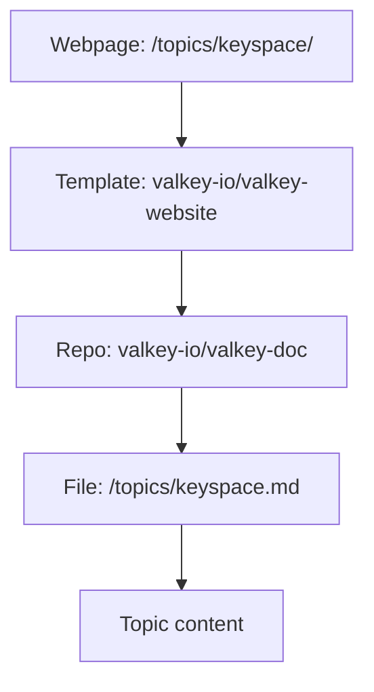
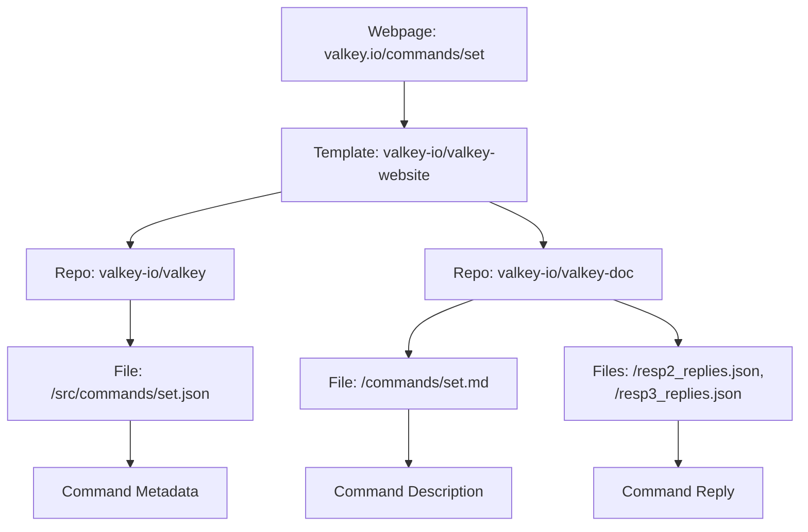

# Valkey.io website

This repo contains the source for the valkey.io website (build scripts, template, blog posts, stylesheets, etc.).
The build integrates content from [`valkey-io/valkey-doc`](https://github.com/valkey-io/valkey-doc) and the commands definitions from [`valkey-io/valkey`](https://github.com/valkey-io/valkey), [`valkey-io/valkey-bloom`](https://github.com/valkey-io/valkey-bloom), and [`valkey-io/valkey-json`](https://github.com/valkey-io/valkey-json) (see [Build Locally](#build-locally) below for more details)

## Contributing

We welcome contributions! Please see our [CONTRIBUTING](CONTRIBUTING.md) page to learn more about how to contribute to the website.

## Security

If you discover potential security issues, see the reporting instructions on our [CONTRIBUTING](CONTRIBUTING.md#security-issue-notifications) page for more information.

## Build Locally

This site is built with [Zola](https://www.getzola.org/) 0.23.

Follow these steps to build the site locally:

1. [Install Zola](https://www.getzola.org/documentation/getting-started/installation/).
2. Switch to the directory with your fork of this repo.
3. Run `zola serve`

Open your browser to `http://127.0.0.1:1111/`

Zola will automatically rebuild on changes to the template or any content stored in this repo.
Changes to external content (command reference, documentation topics) require a restart of the Zola server process (`ctrl-c` then `zola serve` again, a browser refresh may also be needed).

### Checking catalog entries

The clients and integrations entries in `_data/libraries/` are checked by `build/validate-libraries.py`, against the rules in `_data/libraries/schema.json` and the SPDX license list.
CI runs it on pull requests that change the catalog and before every deploy.
To run it locally with [uv](https://docs.astral.sh/uv/), which installs the dependencies pinned in the script's `# /// script` header:

```shell
./build/validate-libraries.py
```

Without uv, install the dependencies listed in that header yourself, then run `python3 build/validate-libraries.py` with the Python version the header requires.

The script downloads the SPDX license list, so it needs network access.

## Building additional content

**By default, the site will build without documentation topics or the command reference.**
The content for documentation topics is stored within the `valkey-io/valkey-doc` repo.
The content for the command reference page is in the `valkey-io/valkey` repo.
The clients and integrations pages (`/clients/`, `/integrations/`) are built from `_data/libraries/` in this repo, so they need no other repo.

If you want to build the site with this content, you'll need to have a local copy of `valkey-io/valkey-doc` and `valkey-io/valkey` _outside_ of this repo.
Then follow the instructions to [build the documentation topics](#building-the-documentation-topics) and/or [build the command reference](#building-the-command-reference).
The instructions show how to use scripts that create symbolic links to the `valkey-io/valkey-doc` and `valkey-io/valkey` repos as well as create a series of empty stub files that tell Zola to create pages.

### Building the documentation topics

Documentation 'topics' (i.e. `/topics/keyspace/`, `/topics/encryption/`, `/topics/transactions/`) source content from `valkey-io/valkey-doc`.



Let's say that this repo and your local copy of `valkey-io/valkey-doc` reside in the same directory.
First, stop the `zola serve` process if you're running it.
From the root directory of this repo run:

```shell
# You should only need to run this once or when you add a new topic.
./build/init-topics.sh ../valkey-doc/topics
```

Then, restart Zola.
Point your browser at `http://127.0.0.1:1111/topics/` and you should see the fully populated list of topics.
All files created in this process are ignored by git.
Commit your changes to your local copy of `valkey-io/valkey-doc`.

### Building the command reference

The command reference (i.e. `/commands/set/`, `/commands/get/`, `/commands/lolwut/`) sources information from `valkey-io/valkey`, `valkey-io/valkey-bloom`, and `valkey-io/valkey-doc`.
`valkey-io/valkey`, `valkey-io/valkey-bloom`, `valkey-io/valkey-json` and `valkey-io/valkey-search` provides the command metadata (items like computational complexity, version history, arguments, etc)
whilst `valkey-io/valkey-doc` provides the command description and the command reply.



Let's say that this repo and your local copy of `valkey-io/valkey-doc`, `valkey-io/valkey-bloom`, `valkey-io/valkey-json`, `valkey-io/valkey-search`
and `valkey-io/valkey` reside in the same directories.

First, stop the `zola serve` process if you're running it.
From the root directory of this repo run:

```shell
# You should only need to run this once or when you add a new command,
# or when a command's group or container changes.
./build/init-commands.sh ../valkey-doc/commands ../valkey/src/commands \
    ../valkey-bloom/src/commands ../valkey-json/src/commands ../valkey-search/src/commands
```

The script uses [jq](https://jqlang.org/), if installed, to store each command's group and container for the documentation menu.
Without jq, the site still builds correctly, but more slowly.

Then, restart Zola.
Point your browser at `http://127.0.0.1:1111/commands/` and you should see the fully populated list of topics.
All files created in this process are ignored by git.
Commit your changes to your local copy of `valkey-io/valkey-doc` for description changes and `valkey-io/valkey` for command JSON changes (if you have any).

### Checking links

Pull requests and deploys check the built site for links to missing pages or `#anchors`, and for valkey-doc links that weren't converted to site URLs.
To run the checks locally (needs [lychee](https://lychee.cli.rs/) and jq), set up the topics and commands as above, then:

```shell
zola build
build/broken-links.sh public
build/unconverted-doc-links.sh public
```

## Blog hero title cards

A blog post can open with a title card instead of its featured image: the post title, as text, in white Open Sans over the Valkey particle-wave background.
It is opt-in, with these keys under `[extra]` in the post's [front matter](CONTRIBUTING-BLOG-POST.md#step-4-put-everything-together):

- `hero_card = true` shows the card in place of `featured_image`, and makes the card's background the link preview unless `og_image` is set.
- `hero_title` (optional) is the card's title when it should differ from `title`, usually to choose the line breaks. Each `\n` in it starts a new line. The page's own title is unchanged.
- `hero_motif = "security"` (optional) makes it the security card: the title on light blocks over the security shield. Its lines wrap in the browser, so the rules below don't apply; set the breaks with `hero_title`. Its link preview is still `default-og.webp`, so set `og_image` too.

CSS can't wrap text by these rules, so on the default card the template, `templates/macros/blog-hero.html`, sets the lines itself:

- A title with a colon becomes a heading and a smaller subheading, split at its first `": "` with the colon dropped, unless the whole title fits on one line at full size. In `hero_title`, a `:` followed by `\n` always splits.
- The heading and the subheading each take one line if they fit, otherwise two, with the first line at least as long as the second and at least two words on the second. Never three. Lines stop short of the wave on the right, and text shrinks to fit, down to 10px on a 390px-wide phone.
- If the heading or the subheading can't fit in two lines at that size, the build fails with an error naming the post. Shorten the title, or set `hero_title` with your own breaks.

The template measures lines with Open Sans's advance widths, in `_data/blog-hero/open-sans-400.json`.
The background is `static/assets/media/blog-hero/default-bg.webp`, and `default-og.webp` beside it is the link preview.
The security card's art, `security-bg.svg`, `security-shield.svg` and `lockup.svg`, is in the same directory.
The styles are in `sass/_blog-hero.scss`.

`build/blog-hero.py` regenerates the width table, which only changes with the Open Sans font files.
Given the background as a 16:9 PNG, it also re-encodes both images:

```shell
./build/blog-hero.py [background.png]
```

It runs with [uv](https://docs.astral.sh/uv/), or with `python3` once Pillow is installed.
The site build never runs it.

## License

This project is licensed under the BSD-3-Clause License.
